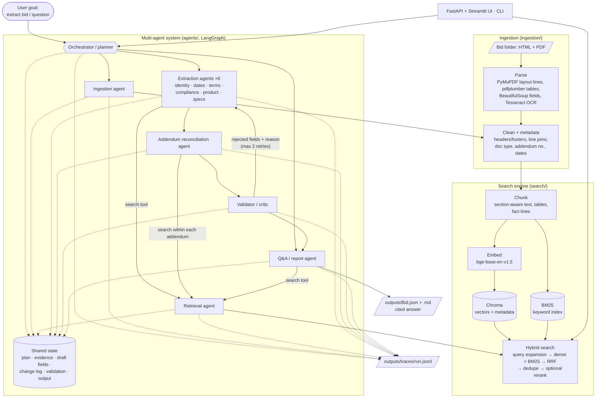

# RFP Intelligence Platform

**▶️ [Demo video](https://youtu.be/juL6Q2Mq6JA)** (Google Drive): a walkthrough of ingestion, search, the agents, Q&A,
comparison and go / no-go.

A retrieval-augmented search engine and a multi-agent system for bid / RFP documents. Point it at a bid
folder (HTML portal pages and PDFs, including addenda) and it will:

- **index** every document: layout-aware parsing, tables, OCR for scanned pages, section-aware chunks;
- **search** it with hybrid retrieval (dense + BM25, Reciprocal Rank Fusion), metadata filters,
  query expansion and optional cross-encoder reranking, always returning file and page citations;
- **extract** a 20-field JSON record per bid with a team of agents that retrieve evidence, extract,
  reconcile addenda, validate and retry, where every value carries its sources and a confidence score;
- **answer questions** about one or several bids with cited answers, or "Not found in documents".

Everything runs locally with open-source models: Qwen3 4B through Ollama for the agents, BGE embeddings
and reranker through ONNX Runtime, Tesseract for OCR. No document leaves the machine.

---

## Contents

1. [Quick start](#1-quick-start)
2. [Architecture](#2-architecture)
3. [Design decisions](#3-design-decisions)
4. [Retrieval evaluation](#4-retrieval-evaluation)
5. [Extraction results](#5-extraction-results)
6. [Deliverables in this repository](#6-deliverables-in-this-repository)
7. [Configuration](#7-configuration)
8. [Project structure](#8-project-structure)
9. [Assumptions and known limitations](#9-assumptions-and-known-limitations)
10. [Deploying beyond a laptop](#10-deploying-beyond-a-laptop)

---

## 1. Quick start

### Setup (once)

```bash
python3.11 -m venv .venv && source .venv/bin/activate
pip install -r requirements.txt
cp .env.example .env

# LLM: install Ollama (https://ollama.com/download), start it, then:
ollama pull qwen3:4b

# Optional, for scanned pages: brew install tesseract   (apt install tesseract-ocr on Linux)
```

The embedding and reranker models (about 1.3 GB) download automatically on first use into
`~/.cache/fastembed`.

### Run each mode

| Mode | Command |
|---|---|
| **Extraction**: index a bid folder and write its 20-field record | `python main.py --bid ./data/Bid1` |
| **Question answering** | `python main.py --ask "What is the submission deadline for Bid1 after all addendums?"` |
| **REST API** | `uvicorn api.app:app --port 8000` (docs at http://127.0.0.1:8000/docs) |
| **Web UI** (needs the API) | `streamlit run ui/app.py` |
| **Search from the CLI** | `python -m search query "proposal due date" --bid Bid1` |
| **Index only** | `python -m search index data/Bid1 data/Bid2` (incremental; `--force` re-parses) |
| **Compare bids** (side-by-side report) | `python main.py --compare Bid1 Bid2` (`--no-summary` skips the model summary) |
| **Go / no-go** recommendation | `python main.py --go-no-go Bid1` (against `company_profile.yaml`; `--profile` for another) |
| **Cost and latency** of past runs | `python main.py --usage` |
| **Retrieval evaluation** | `python -m eval.run_eval` (writes `eval/results.md`) |
| **Sample Q&A log** | `python -m eval.run_qa_log` (writes `docs/qa_log.md`) |
| **Everything in Docker** | `docker compose up -d`, then http://localhost:8501 (see [section 10](#10-deploying-beyond-a-laptop)) |
| **Tests** | `pytest -q` (109 tests, under 1 minute) |

`python main.py --bid <folder>` is the single command for a new bid: it parses and indexes the folder
(skipping files already indexed with the same content), runs the agents, and writes
`outputs/<bid>.json`, a readable `outputs/<bid>.md` and a trace in `outputs/traces/`. Add `-v` to see
each agent step as it happens. It checks first that Ollama is running and the model is pulled.

On a CPU-only laptop (Intel i7-9750H) one bid takes **18–30 minutes**; a question is instant when the
validated record or the semantic cache answers it, and 30–70 s when the model has to, almost all of it LLM time. Search takes well under a second. See [section 10](#10-deploying-beyond-a-laptop) for GPU serving.

### REST API

| Endpoint | Purpose |
|---|---|
| `POST /index` `{"path": "data/Bid3"}` | Index a bid folder in the background; poll `GET /index/{job_id}` |
| `GET /search?q=...&bid_id=Bid1&doc_type=addendum&addendum_number=2&top_k=5` | Hybrid search with citations; filters combine with AND, repeated parameters mean OR |
| `POST /ask` `{"question": "...", "bids": ["Bid1"]}` | Cited answer from the Q&A agents (`bids` optional, inferred from the question) |
| `POST /extract` `{"bid_id": "Bid1"}` | Run the extraction agents in the background; poll `GET /extract/{job_id}` |
| `GET /records/{bid_id}` and `/records/{bid_id}/report` | The extracted JSON record and its Markdown report |
| `POST /compare` `{"bids": ["Bid1", "Bid2"], "summary": true}` | Side-by-side comparison report (JSON and Markdown) |
| `GET /go-no-go/{bid_id}` | Bid / no-bid recommendation with the checks behind it |
| `GET /usage` | Runs, latency, tokens and estimated cost per kind of run; Q&A cache hit rate |
| `GET /bids`, `GET /health` | Indexed bids and documents; index status |

When the API starts it indexes every folder under `data/` (incrementally, so this is instant after the
first time). `POST /index` only accepts folders under `api.index_roots` (`data/` and `samples/` by default),
so the API cannot be pointed at arbitrary paths on the server.

---

## 2. Architecture



**Extraction mode** is a LangGraph graph (`agents/orchestrator.py`):

```
ingest → plan → extract_group ×6 (parallel) → reconcile addenda → validate ─┬→ report → JSON
                                    ▲                                         │
                                    └── retry_field ×n (parallel) ◄───────────┘
                                        rejected fields only, with the validator's reason; max 2 retries
```

**Question-answering mode** is a second graph: `plan` (which bids, is it a comparison?) → `lookup` →
`retrieve` (one branch per bid, in parallel) → `answer`. It answers in three tiers, so that a CPU-only model
stays usable:

1. **Instant, from the validated record (`lookup`, no LLM).** Greetings get a help text; "what are the bids
   about?" gets title, issuer, due date and the document list; "compare the bids" gets a side-by-side
   table of 12 key fields; a question about a field ("when is Bid1 due?", "is a bid bond required?",
   matched by narrow per-field patterns in `agents/fields.py`) gets that field's value and citation.
   Only values the validator passed are used. A question equivalent to one already answered by the model
   (same bids, same numbers, cosine ≥ 0.94) is served from the **semantic cache**. Anything else goes on to
   tier 2.
2. **Written by the model** from the top passages (about 600 tokens, split across bids), with the
   evidence placed before the question so Ollama can reuse an already-read prompt prefix.
3. **Quoted passages** if the model has not answered within `qa.answer_budget_s` (90 s) or returns
   unusable output: the sentence from each top passage that best matches the question, with its
   citation. Nothing generated, so nothing invented.

A bid named in the question ("Bid2", "the Dell laptop bid", "both bids") overrides the bid selected in
the UI; a single shared title word does not. Every answer reports which tier produced it (`mode`).

---

## 3. Design decisions

### Ingestion (`ingestion/`)

- **PDF text is rebuilt from word positions** (PyMuPDF), not read as a stream. Words on the same line
  stay together and a wide gap becomes ` | `, so a label stays with its value
  (`Solicitation Due | 27-JUN-2024 14:00:00`) and a SKU with its description. Justified prose (evenly
  spread words) is detected and not split into columns.
- **Tables** come from pdfplumber, cleaned into grids. Layout boxes are discarded, and form-style grids
  are compacted. They are stored per page and indexed as Markdown.
- **Cleaning:** running headers and footers are found by repetition across pages and removed (the header
  is kept as the document title, e.g. "ADDENDUM No. 1 …"); wrapped lines are rejoined; bullets merged;
  whitespace normalised.
- **Metadata:** `bid_id` (the folder name), `file_name`, `doc_type` (bid_page, rfp, addendum, specs,
  affidavit, other, from the file name and then the opening text), `addendum_number`, `page_number`,
  document date and *where the date came from* (text, HTML field or PDF metadata).
- **Failures never stop a bid:** an unreadable or password-protected file is reported and skipped;
  unsupported file types are listed; pages without a text layer are OCR'd with Tesseract (Bid1's W-9
  pages are vector outlines) or reported as empty.
- **Bid portal pages:** navigation, scripts, forms and hidden inputs are removed before anything is
  indexed, which also drops session tokens and account details. Label/value pairs become fields.

### Chunking (`search/chunking.py`)

- **Section-aware text chunks of at most 350 tokens with 50 tokens of overlap.** A heading (all-capitals
  lines, numbered headings such as `3.2 …`, `Section 4 – …`) starts a new chunk and labels it, so a
  chunk does not mix "pricing" with "insurance". Paragraphs are packed whole and sentences are only split
  when a single paragraph is over budget. Overlap never crosses a section boundary.
  *Why 350:* `bge-base-en-v1.5` truncates at 512 tokens and the token estimate errs low; RFP clauses are
  typically 100–300 tokens, so most chunks hold one complete clause plus its heading.
- **Tables are their own chunks**, in Markdown, with the header row repeated when a large table is split.
- **Fact chunks:** short lines that carry a date, email, phone number or amount, together with the label
  line above them. Header blocks pack a dozen facts into one chunk whose embedding matches none of them
  well; these small chunks make "who is the buyer?" findable. Together with near-duplicate suppression
  they raised Recall@5 from 0.769 to 0.808.
- **Context prefix:** each chunk is embedded and keyword-indexed with `bid | doc type + addendum no. |
  title | section` in front, so a line that only says "due July 9" still matches "Addendum 2 of Bid1".

### Embedding model

`BAAI/bge-base-en-v1.5` (768 dimensions) through fastembed / ONNX Runtime. It is a widely used open
English retrieval model at a size that runs comfortably on a CPU, and ONNX avoids PyTorch, which has no
current builds for Intel Macs. Queries get BGE's retrieval instruction prefix; passages do not.

### Retrieval strategy (`search/hybrid.py`, `search/store.py`)

1. **Query expansion:** procurement synonyms ("deadline" → "due date", "closing date"; "bid bond" →
   "bid security"…) produce up to 3 rewrites. Offline and deterministic; the longest matching phrase wins.
2. **Dense** (Chroma, cosine) and **BM25** search for every variant. BM25 keeps SKUs whole *and* split
   (`210-blyz`, `210`, `blyz`) and uses Lucene's IDF, which stays positive on small corpora where the
   classic Okapi IDF hides terms found in half the chunks.
3. **Reciprocal Rank Fusion** (k = 60) merges all rankings.
4. **Near-duplicate suppression:** a hit that repeats a higher-ranked hit from the same document (a
   table and the page text it came from) is dropped, so results cover more distinct passages.
5. **Cross-encoder reranking** (`bge-reranker-base`) is implemented and evaluated, but **off by default**:
   on our set it did not improve MRR and costs seconds per query on CPU (see below). Enable it per
   request (`rerank=true`) or in `config.yaml`.
6. **Filters** on any metadata (bid, document type, addendum number, file) apply to both retrievers.
7. **Incremental indexing:** a file whose name and SHA-256 are already indexed is skipped; a changed file
   replaces its chunks; a file removed from the folder is removed from the index.

### Agents and framework (`agents/`)

| Agent | Responsibility | Output (Pydantic) |
|---|---|---|
| **Orchestrator / planner** (`orchestrator.py`) | Builds the plan (field groups, or the bids a question is about), routes work, runs the retry loop, decides when done | Execution plan, final record / answer |
| **Ingestion agent** (`ingestion_agent.py`) | Parses and incrementally indexes the folder, reports what it found | Documents + index report |
| **Retrieval agent** (`retrieval_agent.py`) | Runs each field's queries through the search engine (expansion, filters, preferred document types such as specs for part numbers), fuses them and fills a token budget round-robin across fields | `Evidence` passages with citations |
| **Extraction agents** (`extraction_agent.py`) | Six specialists fill their fields from evidence only; citations pruned to passages that support the value | `FieldResult` per field |
| **Addendum reconciliation agent** (`addendum_agent.py`) | Searches *within* each addendum for passages touching the fields, builds a change log, applies the latest change per field | `AddendumChange` log + updated fields |
| **Validator / critic** (`validator_agent.py`) | Checks each field; rejected fields go back with the reason | `ValidationSummary` |
| **Q&A / report agent** (`qa_agent.py`, `report_agent.py`) | Cited answers; bid summary from validated fields; JSON and Markdown report | `Answer`, `BidRecord` |

**Why LangGraph:** the brief's requirements map directly onto its primitives. `Send` fans field groups
and retries out in parallel; reducers merge their results into one typed **shared state**; a
conditional edge implements the **validator → re-extraction loop** with a retry cap; and the graph is
plain Python functions, so each agent is unit-testable without an LLM (the tests run the full graph
against a scripted model). The planner is rule-based rather than an LLM call: the extraction plan is the
same for every bid, and on a CPU every saved LLM call is minutes.

**Shared state** (`ExtractionState`): the plan, all retrieved evidence (by chunk id), draft fields, the
addendum change log, the validation summary, retry feedback, errors and the final record.

**The validator's checks** are deterministic, so they cost no LLM time:
- *citation:* every value needs at least one cited passage;
- *grounding:* every date and number in the value must appear in its cited passages, most of its words
  too; hedged values ("implied", "likely") are rejected; a negative claim ("None", "Not required") must
  be stated by a cited passage;
- *format:* date fields need a parseable date, the due date also a time;
- *consistency:* a field changed by an addendum must carry the latest addendum's value; the due date
  cannot precede the issue date; a delivery date equal to the proposal due date is flagged;
- *not found:* fields nearly every solicitation states (bid number, title, due date…) get one more try.

A rejected field is re-retrieved (its description added as a query, more results per query) and
re-extracted with the rejected value and the reason in the prompt. After 2 retries it is kept but flagged
`failed` with confidence capped at 0.3, so it is visible for review instead of silently dropped.

**Guardrails:** prompts require evidence ids and forbid outside knowledge and inference; unknown
evidence ids are dropped; placeholder strings ("null", "N/A", "not specified") become null with notes
"Not found in documents"; citations are pruned to passages that support the value on their own; a Q&A
answer without a citation is asked again once and otherwise replaced by "Not found in documents"; the
bid summary is written only from validated fields.

### Prompts

All prompts are in the agent modules (`SYSTEM` constants) and share a pattern: role, a numbered list of
rules (evidence only, cite ids, `Not found in documents`, addendum precedence, copy values exactly,
date format), the field descriptions from `agents/fields.py`, then evidence blocks labelled
`[E1] (file, p. N; doc type)`. Outputs are constrained with Ollama's JSON-schema `format`; the schema
puts `evidence_ids` before `value`, because the model fills fields in order and should choose its
evidence before its answer (when the ids were optional and came after the value, the first test run left them empty). Qwen3's thinking
mode is turned off, because its reasoning tokens would multiply CPU latency; it was not evaluated for
accuracy.

### Observability and error handling

- **Traces:** every agent step appends a JSON line to `outputs/traces/<run_id>.jsonl` with agent,
  action, input, tool calls (each search with its query, filters and hits; each LLM call with tokens),
  output, prompt/output tokens, latency and error. Run totals (LLM calls, tokens, seconds, errors) are
  stored in each record's `run` block.
- **Errors:**
  - an LLM timeout is retried;
  - invalid JSON is sent back to the model with the validation error;
  - after that the affected fields are marked failed;
  - empty retrieval skips the LLM and returns "Not found in documents";
  - an exception in a search step, field group or addendum check fails only that part, and the run
    completes with the error listed in `run.errors`.

---

### Comparison, go / no-go, caching and cost tracking

- **Comparison agent** (`agents/comparison_agent.py`). The side-by-side table and the "key differences"
  (deadline order, bonds, submission, delivery, contract term, purchasing vehicle, fields to check by hand)
  are computed from validated values, so they are exact and cited. The model then writes a short summary
  citing table cells by id; a summary without a valid citation is dropped. About 75 s on CPU with the
  summary, instant without (`--no-summary`).
- **Go / no-go agent** (`agents/go_no_go_agent.py`). Rule-based on purpose, so each decision can be
  explained and challenged line by line: deadline (days left against `min_days_to_prepare`), product fit,
  manufacturer authorisation, bid-bond percentage, installation, submission method, delivery window,
  contract length and required documents, each against `company_profile.yaml`. **NO-GO** if any check
  fails, **REVIEW** if something needs a person (including any value the validator did not confirm), else
  **GO**. The example profile is for a fictional reseller and assesses the 2024 sample bids as of
  1 June 2024; assessed as of today they are NO-GO because they have closed.
- **Semantic cache** (`agents/qa_cache.py`). A question is answered from the cache when an earlier one with
  the same bids has cosine similarity ≥ 0.94 *and* the same numbers. The threshold was measured: rewordings
  scored 0.945–0.995 and different-but-similar questions up to 0.909 ("…Addendum 2?" vs "…Addendum 1?",
  which the number rule also separates). Entries expire when the index or a bid's record changes. Only
  model-written answers are cached; record answers are instant anyway.
- **Cost and latency per run** (`agents/usage.py`). Every extraction, question, comparison and go/no-go
  appends one line to `outputs/runs.jsonl`: seconds, LLM calls, prompt and output tokens, time per agent,
  cache hit and an estimated cost from `costs` in `config.yaml` (0 for the local model; enter a hosted
  provider's prices to compare). Extraction records also carry these in `run`.
- **Output cap.** Every LLM call is capped (`agents.max_output_tokens`, 400 for answers and summaries):
  qwen3:4b once looped inside a JSON string for over 3,000 tokens (about 10 minutes) before the cap existed.

## 4. Retrieval evaluation

`eval/questions.yaml` holds **26 questions** over both bids, each mapped to the passage(s) that answer it
(file + text, so the set survives re-chunking). Questions are phrased as an analyst would ask, often in
different words from the document. Each search is filtered to its bid. Each configuration adds one stage
to the previous one:

| Configuration | Recall@1 | Recall@3 | Recall@5 | MRR | Latency / query |
|---|---|---|---|---|---|
| BM25 only | 0.500 | 0.750 | 0.769 | 0.689 | 0.006 s |
| Dense only | 0.462 | 0.558 | 0.654 | 0.608 | 0.035 s |
| Hybrid (dense + BM25, RRF) | 0.615 | 0.673 | 0.750 | 0.750 | 0.041 s |
| + query expansion | 0.615 | 0.712 | 0.750 | 0.756 | 0.154 s |
| **+ near-duplicate suppression (default)** | **0.615** | **0.712** | **0.808** | **0.759** | 0.162 s |
| + cross-encoder rerank | 0.596 | 0.750 | 0.788 | 0.747 | 6.12 s |

Reproduce with `python -m eval.run_eval`; per-question ranks are in `eval/results.json`.

**Reading the table:**
- Hybrid beats either retriever alone. BM25 is strong, probably because RFPs repeat their own
  terminology and contain many exact identifiers; dense retrieval helps with paraphrased questions.
- Expansion and dedupe each add a little.
- The reranker improves Recall@3 but lowers MRR, at about 40× the latency, so it is off by default.
- With 26 questions one question moves recall by about 0.04, so differences smaller than that are
  within noise. For the same reason I did not tune weights against this set (variant weights of 0.25
  and 0.5 were tried and showed no consistent gain).

**What still misses** are mostly label/value header blocks (the buyer's name, "Questions Due By") whose
answer sits in a dense block of unrelated fields. The fact chunks were added for exactly this and fixed
part of it.

---

## 5. Extraction results

Final run with `qwen3:4b` on CPU. Each value was checked by hand against the documents. "Flagged" means
the validator rejected the value after its retries, so the record marks it `failed` with confidence ≤ 0.3
for human review.

| | Correct | Partial | Wrong | Validator (passed / failed / not found) | Run |
|---|---|---|---|---|---|
| **Bid1** | 13 | 4 | 3 | 14 / 2 / 3 | 27.5 min, 13 LLM calls, 3 validation rounds |
| **Bid2** | 16 | 4 | 0 | 14 / 1 / 4 | 17 min, 11 LLM calls, 3 validation rounds |
| **Bid3** (fictional, unseen) | 15 | 4 | 1 | 19 / 0 / 0 | 15 min |

**Bid3 is not part of the assignment's sample data.** It is a fictional bid generated for this project
(`python eval/make_sample_bid.py` → `samples/Bid3`, answer key in `eval/bid3_answer_key.md`) to test an
unseen bid folder. It was added through the UI's "Add a bid folder" (bid ID `BID3`, so its record is
`outputs/BID3.json`), with no code changes. Correct: the due date from Addendum 1 (21 March, not the RFP's 14 March), the
delivery window (not the award date), Net 45, the 5% bid bond, part numbers from the price table, the
OCR'd affidavit in the documents list. Partial: title, pre-bid room number, installation detail, and
Product without quantities, so the addendum's 120 → 135 change is not reflected. Wrong: Bid Submission
Type returned the bid-bond payment wording, and the validator passed it (19/19) because the value does
appear in the cited text.

| Field | Bid1 | Bid2 |
|---|---|---|
| Bid Number | ✅ JA-207652 | ✅ #E20P4600040 (the eMMA number BPM044557 is not given) |
| Title | ✅ | ✅ |
| Due Date | ✅ **2024-07-09 14:00 CST, from Addendum 2** (original 27-JUN-2024) | ✅ 2024-06-10 14:00 EDT |
| Bid Submission Type | ✅ electronic (iSupplier), sealed hard copy allowed | ✅ eMMA only |
| Term of Bid | ✅ 3 years + two 1-year renewals, 5 years max | ✅ not found (a one-off purchase order) |
| Pre Bid Meeting | ✅ 10 June 2024, attendance not required | ✅ not found |
| Installation | ✅ Yes (white-glove deployment, etching, tagging) | ✅ not found |
| Bid Bond Requirement | ⚠️ "Not required", flagged (documents are silent) | ✅ not found |
| Delivery Date | ✅ not found | ⚠️ "06/10/2024", flagged (true value: within 45 days of award) |
| Payment Terms | ❌ a prime-to-subcontractor payment rule | ⚠️ invoicing instructions correct, plus a vendor's credit terms |
| Any Additional Documentation | ⚠️ M/WBE forms, W-9 (misses Form 1295 and others) | ⚠️ Mercury Affidavit (misses the Contract Affidavit) |
| MFG for Registration | ⚠️ "Manufacturer or Authorized Reseller", too vague | ✅ Dell |
| Contract or Cooperative | ✅ Central Texas Purchasing Alliance (interlocal) | ✅ Desktop, Laptop and Tablet 2015 Master Contract 060B5400007 |
| Model_no | ✅ not found (the RFP specifies tiers, not models) | ✅ Latitude 5550; WD22TB4 |
| Part_no | ✅ not found | ⚠️ "SI# CC7802; 30" (30 is the quantity; the Dell SKUs are missed) |
| Product | ❌ only the monitors; misses Chromebooks, laptops, tablets and desktops | ✅ Latitude 5550 laptop and WD22TB4 dock |
| Product Specification | ⚠️ good content, flagged (values spread over several passages) | ✅ CPU, OS, memory, storage, display |
| contact_info | ✅ buyer name and email | ✅ name, phone, email |
| company_name | ✅ Dallas Independent School District | ✅ State of Maryland Treasurer's Office |
| Bid Summary | ❌ describes the bid as monitors, inheriting the Product error | ✅ |

**What worked:**
- The addendum trap: Bid1's due date comes from Addendum 2, cited to it.
- Fields the documents are silent on came back as "not found" rather than invented: 7 of them.
- The validator → retry loop caught and rejected the unsupported values; in development it fixed
  hallucinated "None" and "Not required" answers and a delivery date taken from a "due date" column.

**What did not:**
- **Completeness on long, multi-category bids.** Bid1's Product misses most categories, and its
  documents list is incomplete.
- **Semantic mix-ups that pass grounding,** such as the subcontractor payment rule.
- **The addendum change log is noisy.** It records Addendum 2's change as a clarification without the
  new value (the Due Date field itself is correct and cited to Addendum 2), and lists near-duplicate
  Addendum 1 notes. On Bid3 it labelled a quantity change (120 → 135) a clarification, so it was not
  applied to Product.
- **The validator checks grounding, not relevance:** a value copied from the right document but for the
  wrong field (Bid3's submission type) passes. "Passed" therefore means "supported by the cited text",
  not "correct".

These are the main targets for a larger model and more evidence per field (section 9).

---

## 6. Deliverables in this repository

| Deliverable | Where |
|---|---|
| Source code | `ingestion/`, `search/`, `agents/`, `api/`, `ui/`, `eval/`, `main.py` |
| JSON output per bid (values, citations, confidence) | `outputs/Bid1.json`, `outputs/Bid2.json` (+ readable `.md`) |
| Retrieval evaluation (questions + results) | `eval/questions.yaml`, `eval/results.md`, `eval/results.json` |
| Sample Q&A log (cited answers) | `docs/qa_log.md` |
| Agent trace of a full extraction run | `docs/example_trace.jsonl` |
| Demo video | [Google Drive](https://drive.google.com/file/d/1Zlkola6VfkBY5ATsIDoeHQX5rjK6aYuT/view?usp=drive_link) |
| Architecture diagram | [Section 2](#2-architecture) |
| Tests | `tests/` (parsing, chunking, index, search, API, agents, reports) |

**Bonus items (section 12 of the brief)**

| Bonus | Where |
|---|---|
| Web UI for search and chat | `ui/app.py` (Streamlit): bid overview, Ask, Compare, Search, Documents |
| OCR for scanned PDFs | `ingestion/pdf_parser.py` (Tesseract for pages without a text layer) |
| Bid comparison agent | `agents/comparison_agent.py`; report in `outputs/comparisons/Bid1_vs_Bid2.md` |
| Go / no-go recommendation | `agents/go_no_go_agent.py`, `company_profile.yaml`; results in `outputs/go_no_go/` |
| Semantic caching, cost and latency per run | `agents/qa_cache.py`, `agents/usage.py`; `python main.py --usage`, `GET /usage` |
| Docker and CI | `Dockerfile`, `docker-compose.yml` (+ `docker-compose.gpu.yml`), `.github/workflows/ci.yml` |

---

## 7. Configuration

- **`.env`:** model names and locations (`LLM_MODEL`, `OLLAMA_BASE_URL`, `EMBEDDING_MODEL`,
  `RERANKER_MODEL`, `INDEX_DIR`, `DATA_DIR`, `API_URL`, `MODEL_CACHE_DIR`). No secrets are needed or
  stored in code.
- **`config.yaml`:** tunable parameters:
  - chunk size and overlap
  - retrieval depth, RRF constant, rerank on/off, expansion
  - agent retries, parallelism, temperature, context window, LLM timeout, how long Ollama keeps the
    model loaded (`keep_alive`)
  - Ask: time budget before falling back to quoted passages (`qa.answer_budget_s`) and passage tokens
    per question (`qa.passage_tokens`)
  - OCR and header-detection thresholds
  - indexing on API start-up

  Point `RFP_CONFIG` at another file to swap it.

---

## 8. Project structure

```
ingestion/     parsing (PDF layout + tables + OCR, HTML), cleaning, metadata, folder pipeline
search/        chunking, embeddings, Chroma + BM25 store, query expansion, hybrid search, reranker, CLI
agents/        orchestrator (LangGraph), retrieval, extraction, addendum, validator, Q&A, report,
               comparison, go/no-go, semantic cache, usage ledger, tracing, fields
schemas/       Pydantic models: documents, chunks, agent messages and the bid record
api/           FastAPI app
ui/            Streamlit app (bid overview, chat, compare, search, documents)
eval/          retrieval question set and runner, Q&A log runner, fictional Bid3 generator and answer key
tests/         109 tests; the agent tests run the full graph against a scripted LLM
data/          bid folders indexed at API start-up (one folder per bid)
samples/       generated test bid (Bid3), added from the UI or the CLI
outputs/       extracted records and reports, comparisons/, go_no_go/, traces
docs/          sample Q&A log, example agent trace
main.py        one-command entry point
config.yaml    tunable parameters        company_profile.yaml   capabilities for go / no-go
Dockerfile, docker-compose.yml, docker-compose.gpu.yml, .github/workflows/ci.yml
```

---

## 9. Assumptions and known limitations

**Assumptions**
- One folder is one bid; the folder name is the bid id.
- Files are HTML or PDF; other types are listed as skipped.
- Document types are inferred from file names, then from the opening text.
- An addendum's number comes from its file name or title.
- A higher addendum number overrides a lower one and the base RFP.
- Dates are reported as written (time zone included); "2:00 PM CST" in July is kept as CST although
  daylight time applies, because that is what the document says.
- When documents are silent on a field (e.g. no bid bond mentioned), the record says "Not found in
  documents" rather than inferring "Not required".

**Limitations**
- **Accuracy is bounded by a 4B model on CPU.** The validator catches unsupported values and retries
  them, but a small model sometimes repeats a rejected answer; those fields are flagged `failed` for
  review. A larger model on a GPU should do better (untested here).
- **The validator checks grounding, not meaning.** A value whose numbers and words appear in its cited
  passage passes even if it answers a slightly different question (e.g. a subcontractor payment rule
  offered as "payment terms").
- **List fields** (products, part numbers, documents) can be incomplete in long bids, because evidence per
  field group is capped at about 1,600 tokens to keep CPU prompts fast.
- **Speed:** 18–30 minutes per bid on CPU. In Ask, field, overview and comparison questions answer in
  under a second; free-form questions need qwen3:4b for about 40–90 s. qwen3:1.7b answered in 20–25 s
  but about one answer in three contained a wrong or invented detail (e.g. a form date given as the
  delivery date), so 4b stays the default.
- **Unseen bids:** nothing in the code refers to the sample bids. A fictional third bid with a known answer
  key (`python eval/make_sample_bid.py` → `samples/Bid3`, key in `eval/bid3_answer_key.md`) tests
  addendum precedence, OCR, tables and date traps; it is generated, not a real solicitation.
- **Document titles** come from the running page header when there is one, so a header such as
  "District | RFP number" becomes the title. Questions that name a bid by its subject ("the projector
  bid") then may not be routed to it; naming the bid id always works.
- **Layout:** two-column PDF prose would interleave (the sample documents are single-column); addendum
  dates come from PDF metadata when the text has none (the source is recorded).
- **Query expansion** uses a hand-written synonym list for procurement terms; it does not learn.
- **The API has no authentication.** It is built for local use or behind an authenticating proxy (see
  below); `POST /index` is limited to folders under `api.index_roots`.
- **Go / no-go is keyword- and rule-based.** It reads the extracted values, so it inherits extraction errors
  (BID3's wrong submission method makes its Submission check "review"), and its product, manufacturer and
  document matching is by keyword from `company_profile.yaml`, not by meaning.
- **The comparison summary and Q&A answers inherit the records' errors** (e.g. Bid1's product list), since
  they are built from the extracted values; the table marks every value that was not validated.
- **The semantic cache trades recall for safety:** looser rewordings (similarity around 0.86) are not
  recognised as repeats and are answered again.
- **Docker was validated by CI (build, compose config, smoke test), not run end to end on the development
  machine;** the Ollama image tag is `latest` and should be pinned for a real deployment.

---

## 10. Deploying beyond a laptop

### Docker

```bash
docker compose up -d                                                     # any machine, CPU
docker compose -f docker-compose.yml -f docker-compose.gpu.yml up -d     # NVIDIA GPU server
```

This starts Ollama, pulls `LLM_MODEL` (default `qwen3:4b`, about 2.5 GB), then the API and the UI; open
http://localhost:8501. The image (`Dockerfile`, Python 3.11 slim with Tesseract) is shared by the API and
the UI. `data/` and `samples/` are mounted read-only, `outputs/` read-write, and the index, model cache and
Ollama models live in named volumes, so nothing is downloaded twice. Only the UI port is published; the API is
bound to localhost and Ollama is internal.

The CI pipeline builds this image and validates both compose files on every push; the stack was not run
locally (Docker is not installed on the development machine). On macOS, Docker cannot use the Apple GPU, so
Ollama in a container runs on CPU; to use the host's Ollama instead, set
`OLLAMA_BASE_URL=http://host.docker.internal:11434` for the `api` service. On a Linux host, the container
runs as uid 1000, so `outputs/` must be writable by that user.

### CI (`.github/workflows/ci.yml`)

On every push to `main` and every pull request:

1. **Lint and tests:** `ruff check`, `ruff format --check`, `pytest`.
2. **Retrieval evaluation:** indexes the sample bids and runs all six configurations
   (`python -m eval.run_eval --available-only`). The saved BidNet pages are not in the repository, so the
   6 expected passages from them are dropped (25 of 26 questions remain) and the numbers differ slightly
   from `eval/results.md`; the results appear in the job summary and as an artifact.
3. **Docker:** validates the compose files, builds the image and runs a smoke test.

### Going live

- **LLM:** a GPU server running Ollama (the GPU compose file), or vLLM for many concurrent users behind a
  small provider class implementing the `LLM` protocol in `agents/llm.py`. A larger model is the main
  accuracy lever (untested here).
- **Required before exposing it to the internet:**
  - an authenticating reverse proxy (e.g. Caddy or nginx with SSO or basic auth) and HTTPS in front of the
    UI; the API and UI have no login of their own;
  - keep the API and Ollama off the public network (as the compose file does);
  - replace folder indexing (`api.index_roots`) with uploads if users should add bids;
  - move the in-process job queue to a worker if several people extract at once.
- **Data handling:** bid documents and portal pages may contain customer and account data; the parser
  strips portal session data before indexing, but raw files should be stored and shared accordingly.
